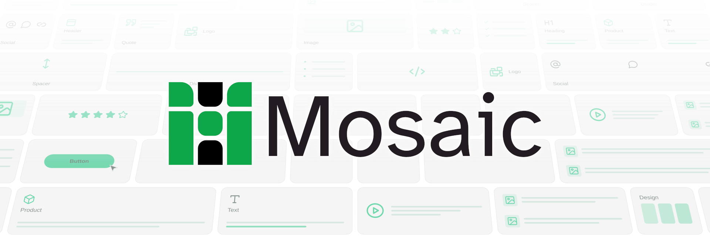

## Email production, without the bottlenecks.

Mosaic brings visual authoring, brand governance, and production-ready output into one connected workspace. Build reusable content for email campaigns, control design standards across Libraries, and review work before completion—without making routine changes a development project.

<table width="100%">
  <tr>
    <td width="52" align="left" valign="top">
      
    </td>
    <td valign="top">
      <strong>Visual, modular creation</strong> 
      Build responsive email content from reusable modules, templates, and personalized variations.
    </td>
  </tr>
</table>

<table width="100%">
  <tr>
    <td width="52" align="left" valign="top">
      
    </td>
    <td valign="top">
      <strong>Governance by design</strong> 
      Manage shared Libraries, brand configuration, components, and user permissions.
    </td>
  </tr>
</table>

<table width="100%">
  <tr>
    <td width="52" align="left" valign="top">
      
    </td>
    <td valign="top">
      <strong>Review with context</strong> 
      Inspect desktop and mobile presentations, including light and dark appearances, before completing an email.
    </td>
  </tr>
</table>

<table width="100%">
  <tr>
    <td width="52" align="left" valign="top">
      
    </td>
    <td valign="top">
      <strong>Production-ready artifacts</strong> 
      Compile deterministic email HTML and apply platform-specific formatting through integrations.
    </td>
  </tr>
</table>

### More than email

Mosaic also supports channel-native SMS and RCS content authoring. Authoring and exporting content are separate from sending or orchestrating campaigns; Mosaic does not operate as a delivery platform.

## Built to extend.

Mosaic integrations are independently versioned packages that extend the platform without requiring core application changes for every provider-specific capability.

| Integration | What it enables |
| :--- | :--- |
| [**FlatPack**](https://github.com/mosaic-email/integrations/tree/main/integrations/flatpack) | Convert selected modules or groups into responsive image assets with independent links and content variations. |
| [**Google Fonts**](https://github.com/mosaic-email/integrations/tree/main/integrations/google-fonts) | Bring governed Google Fonts families into the typography workflow. |
| [**Salesforce Marketing Cloud**](https://github.com/mosaic-email/integrations/tree/main/integrations/sfmc) | Produce SFMC-specific formatting and personalization syntax in email output. |

Explore the [official Mosaic integrations repository](https://github.com/mosaic-email/integrations) for published packages and release information. Developer integration documentation and community submission processes will be published when available.

---

  
<strong>Made for the people behind every send.</strong>

  
<a href="https://mosaic-email.com">mosaic-email.com</a>

  Mosaic is a product of Locki Dynamics LLC. © 2026 Locki Dynamics LLC. All rights reserved.

